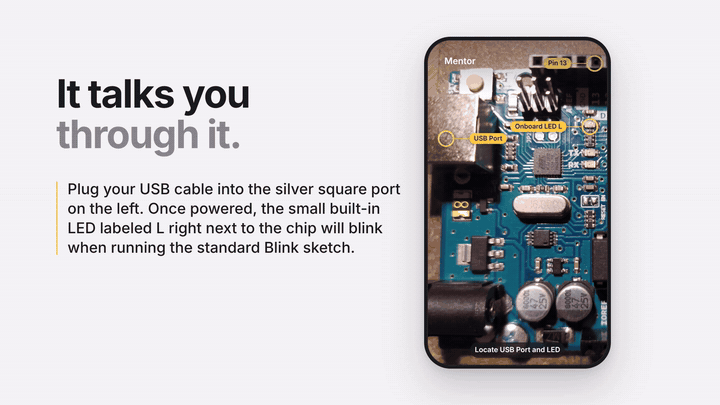
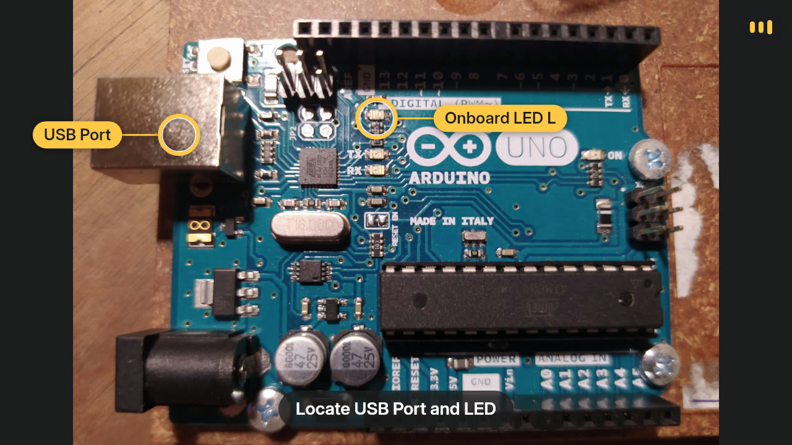
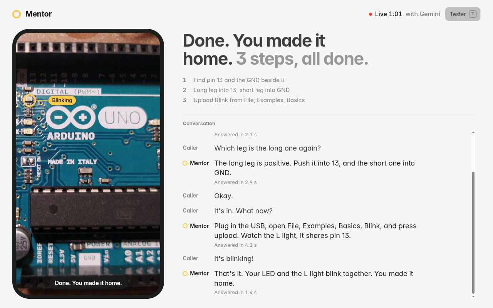
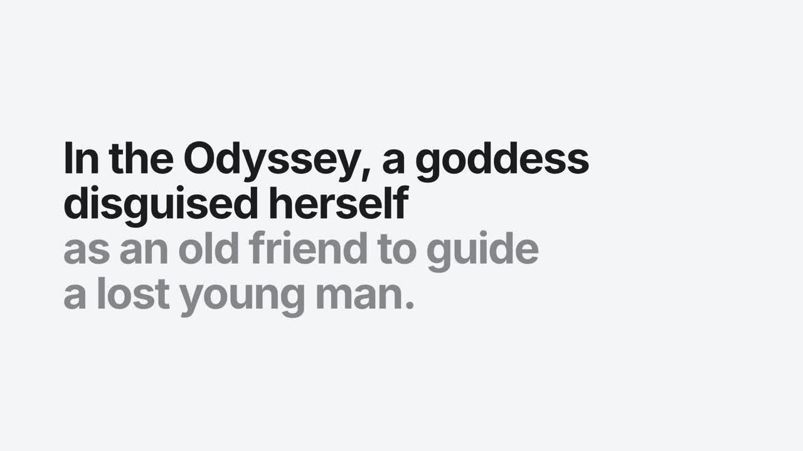
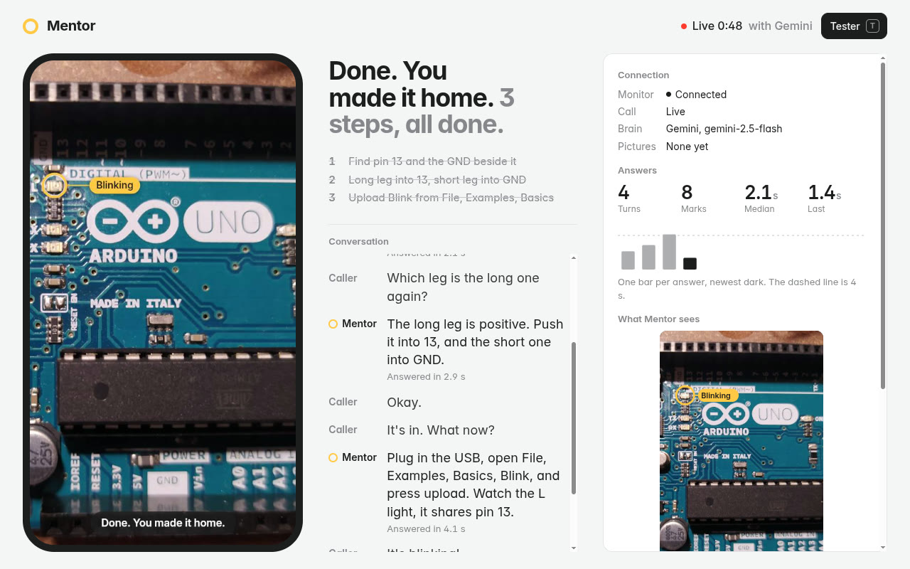
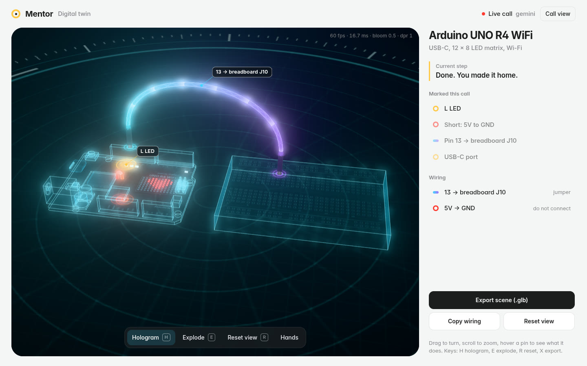
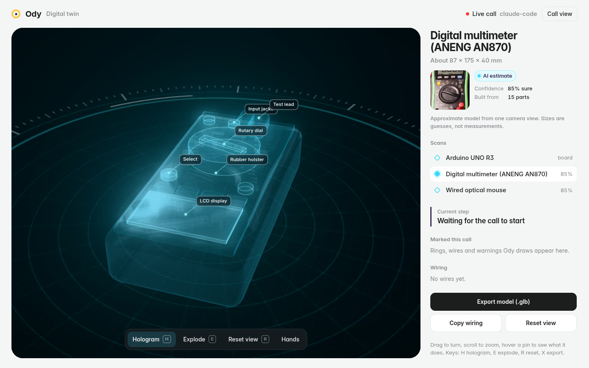
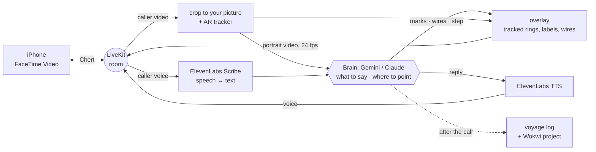

<div align="center">



# Ody

**FaceTime an AI that can see your project and point at it.**

You call it from the normal FaceTime app. It looks through your camera, draws on *your own live video*,<br>
talks you through the build one step at a time, and texts you a voyage log when you hang up.

[](#built-at-hackuta-2026)
[](https://www.trychert.com)
[](https://github.com/livekit/agents-js)
[](https://elevenlabs.io)
[](https://ai.google.dev)
[](LICENSE)

[Watch the film](docs/ody-film.mp4) · [How it works](#how-it-works) · [Features](#features) · [Run it](#run-it) · [Security](SECURITY.md)

</div>

---

> *In the Odyssey, a goddess disguised herself as an old friend to guide a lost young man home. His name was Mentor.*

## The idea

When you're stuck on something physical, like a first Arduino, a loose wire or a kit with no manual, instructions
and videos can't see *your* parts, and a chatbot can't point. The person who could help is rarely sitting next to you.

Ody is that person, on a FaceTime call:

1. **You FaceTime it.** It's a plain FaceTime Video call from an iPhone. There's no app to install.
2. **It asks to see your parts** and works out exactly what you have (an UNO R3 is not an UNO R4).
3. **It points on your own video.** Rings, labels and wires land on the real port, LED or pin, and stay on them as you move.
4. **It talks you through it**, one short step at a time, and checks each step on camera before moving on.
5. **It texts you a voyage log** when you hang up: every step with its annotated picture, your final code, and a runnable simulator project.

<table>
<tr>
<td width="50%"><br><sub><b>Real model output.</b> Gemini found the USB port and the L LED; Ody's overlay drew them.</sub></td>
<td width="50%"><br><sub><b>The laptop screen</b> at <code>localhost:8790</code> mirrors the call for judges (shown with mock data).</sub></td>
</tr>
</table>

## The Odyssey, mapped

| In Homer | In Ody |
|---|---|
| Telemachus, young and stuck, not knowing where to start | You, holding a board you've never used |
| Athena arrives *disguised* as Mentor, an old friend | An AI that arrives as an ordinary FaceTime contact: no app, no new interface |
| She doesn't sail the ship for him; she shows him what to do next | Ody never does the build. It points at the next thing on *your* camera and waits for you |
| The voyage, one island at a time | The build, one leg at a time, each one checked on camera |
| *Nostos*, the homecoming | "Done. You made it home." The LED blinks, and the voyage log arrives |

**Every Telemachus deserves a Mentor.**

## Features

| | |
|---|---|
| **AR marks that stick** | Rings and labels follow each part as your phone moves: a pyramidal Lucas-Kanade tracker in plain JS, with no dependencies. Synthetic handheld test: 1.6 px mean error at about 1 ms per frame. |
| **AR wires on the exact hole** | "Where does this wire go?" On an Arduino UNO (R3 / R4 WiFi), Ody registers the board from its 4 corners, snaps them to the real header holes, and draws a holographic 3D jumper from the exact pin hole, arcing up out of the board and staying registered as the phone moves (`board.mjs`). |
| **3D hologram on your laptop** | The board Ody recognises appears at `localhost:8790/twin` as an Iron Man-style hologram: Ody's rings and holographic jumpers in 3D between the exact holes, explode view (E), hover any pin for its name and function, export the scene as `.glb`. Hand control: pinch to rotate and fist to grab, tracked on the laptop with MediaPipe, and the video never leaves it. |
| **Scan anything** | "Scan this" turns whatever is on camera into an approximate 3D model (an AI-built shape assembly with your photo wrapped on), shown in the hologram and exportable. Known boards use their exact model. Labelled as an AI estimate from one view. |
| **Parts library** | 18 boards and modules with exact pin maps (Arduino UNO, Mega, Nano; ESP32; Raspberry Pi 4 and Pico; NodeMCU; breadboard; HC-SR04, DHT22, SG90, MPU6050…), imported from Wokwi and Fritzing by `tools/import-parts.mjs`. |
| **Clean view by default** | Your phone shows just your camera. Ody draws only when you ask where, what, or how to connect something, and marks fade after about 10 s. Safety warnings always show. |
| **Stop signs** | It circles a short, a missing resistor or reversed polarity in red and says "Stop," before you power on. |
| **Knows your exact board** | It identifies the part first (UNO R3 USB-B vs UNO R4 USB-C) and points at *that* board's layout. |
| **"Show me again"** | Instantly re-shows the last marks and repeats the last line, with no model call. |
| **Your language** | `MENTOR_LANG=auto`: speak Spanish or Hindi and Ody answers in it. |
| **Portrait, full-screen** | It finds your real picture inside FaceTime's frame, drops the self-view, and sends portrait video back that fills your phone. |
| **Voyage log** | After the call: the steps as legs of a journey, each with its annotated picture, ending in "Home". It also writes `sketch.ino` and `diagram.json` for the Wokwi simulator. |
| **Laptop screen + tester panel** | Judges see the call live. Press **T** to see what Ody sees, where it pointed, latency per answer, the model and the frame rate. |
| **Robust brain** | Gemini, Claude, or (owner testing only) Claude Code. On a rate limit it falls through Gemini models. Acknowledgements like "okay" skip the model. |

<table>
<tr>
<td width="50%"></td>
<td width="50%"><br><sub>The tester panel (press <b>T</b>), shown with mock data.</sub></td>
</tr>
</table>

<table>
<tr>
<td width="50%"><br><sub><b>The 3D twin</b> at <code>/twin</code>: Ody's marks and wires in 3D (mock replay).</sub></td>
<td width="50%"><br><sub><b>Scan anything:</b> a multimeter from one camera view, about 13 s (AI estimate).</sub></td>
</tr>
</table>

## How it works



- **[Chert](https://www.trychert.com)** gives the agent a real Apple line. It answers FaceTime, bridges the call into a
  [LiveKit](https://livekit.io) room, and sends iMessages.
- **The agent** (Node, `@livekit/agents`) reads the caller's camera and keeps only the newest frame. It crops away
  FaceTime's bars and self-view, and publishes its own portrait video track: your picture with Ody's tracked marks on top.
- **ElevenLabs** listens (Scribe v2 realtime) and speaks (Flash v2.5).
- **The brain** gets what you said plus the frame from the moment you finished speaking, and returns structured JSON:
  - what to say
  - where to point (circles, arrows, wires, warnings)
  - the current step
  - a note for the log

  It's called once per spoken turn, never per frame. Between answers, the tracker keeps the marks on their parts.

## Run it

**You need:**
- Node 22.23+ / 24 / 26
- an iPhone with FaceTime
- a [Chert](https://www.trychert.com) line (free trial)
- a LiveKit Cloud project (free)
- an ElevenLabs key
- a Gemini key (free in Google AI Studio) or an Anthropic API key

```sh
git clone https://github.com/hippoFan/mentor && cd mentor
cp env.example .env              # fill it in; never commit .env
cd agent && npm install
npm run check-keys               # verifies every key without printing it or spending model requests

npm start                        # terminal 1: the agent
chert setup --env-file ../.env --project <project-id>    # terminal 2, once (chert = npx @trychert/facetime@0.1.0-beta.21)
chert dev --agent <your AGENT_NAME>
```

FaceTime **Video** the number `chert dev` shows, and open **http://localhost:8790** on the laptop.

<details>
<summary><b>Test without a phone</b></summary>

```sh
npm run try-brain -- photo.jpg "where is the USB port?"   # one brain answer drawn on a photo
MENTOR_TEST_TURN="what is this board?" npm start            # terminal 1
npm run e2e -- photo.jpg ./e2e-out                          # terminal 2: a fake caller streams the photo, saves Ody's
                                                            # frames and measures Ody's audio loudness
node test/track-test.mjs                                    # AR tracker accuracy + speed
node test/recap-test.mjs                                    # voyage log, escaping, recap server hardening
node test/mock-monitor.mjs                                  # the laptop screen with a replayed call, on :8799
```
</details>

<details>
<summary><b>Configuration</b> (all in <code>.env</code>, see <a href="env.example"><code>env.example</code></a>)</summary>

| Variable | Required | What it is |
|---|---|---|
| `LIVEKIT_URL`, `LIVEKIT_API_KEY`, `LIVEKIT_API_SECRET` | yes | One LiveKit project, the same one `chert setup` uses |
| `AGENT_NAME` | yes | Unique dispatch name, also passed to `chert dev --agent` |
| `ELEVENLABS_API_KEY` | yes | ElevenLabs key with Text to Speech + Speech to Text |
| `GEMINI_API_KEY` / `ANTHROPIC_API_KEY` | one of them | The brain |
| `MENTOR_BRAIN` | no | `gemini`, `claude`, or `claude-code` (**owner testing only**, also needs `MENTOR_OWNER_TESTING=1`; see [SECURITY.md](SECURITY.md)) |
| `MENTOR_GEMINI_MODELS` | no | Models to fall through on rate limits (default `gemini-3.5-flash,gemini-3.5-flash-lite,gemini-2.5-flash`) |
| `MENTOR_TASK` | no | What Ody guides, e.g. `Make the Arduino's onboard LED blink` |
| `MENTOR_LANG` | no | `en` (default) or `auto` (answer in the caller's language) |
| `MENTOR_OUT` / `MENTOR_FPS` | no | `portrait` (default, 540×960) or `landscape`; frames per second back into the call (default 24) |
| `MENTOR_OVERLAY` | no | `demand` (default): the caller's video stays a plain camera; marks appear only when they ask where/what/show/connect (or for a safety warning) and fade after 10 s. `always`: the old always-on overlay (step caption, voice bars, every mark) |
| `MENTOR_SHOW_SPEAKING` | no | `1` shows Ody's voice bars on the caller's video |
| `MENTOR_SCAN_EFFORT` | no | Effort for "scan this" 3D scans (default `medium`) |
| `MENTOR_MAX_TURNS` | no | Brain calls per call before Ody wraps up (default 60) |
| `ELEVEN_VOICE_ID`, `MENTOR_GREETING` | no | Ody's voice and first line |
| `CHERT_API_KEY`, `CHERT_PROJECT_ID`, `MENTOR_RECAP_TO`, `MENTOR_PUBLIC_URL`, `MENTOR_SEND_RECAP=1` | for the iMessage recap | Off unless `MENTOR_SEND_RECAP=1` |
</details>

<details>
<summary><b>Project layout</b></summary>

```
agent/
  agent.mjs            the call: camera in, tracked marks out, voice, snapshots, stats
  brain.mjs            prompt, schema, output sanitiser, brain picker (+ Claude API brain)
  brain-gemini.mjs     Gemini brain with model fallback
  brain-claude-code.mjs  owner-testing brain on the local Claude Code CLI (locked down)
  overlay.mjs          what the caller sees: crop, rings, labels, AR wires, warnings
  tracker.mjs          pyramidal Lucas-Kanade point tracker (no deps)
  board.mjs            UNO registration: homography + pose from 4 corners, hole snapping, 3D jumper geometry
  data/uno-pins.json   UNO header hole positions (from wokwi-elements, MIT)
  live.mjs, monitor.html   the laptop screen (local only, Origin/Host checked)
  recap.mjs, send-recap.mjs, serve-recaps.mjs   voyage log, Wokwi files, iMessage
  check-keys.mjs, status.mjs   key + line checks
  chert-rooms.mjs, greet.mjs   from Chert's video-agent starter
  test/                e2e fake caller, tracker, recap, dashboard mock
docs/                  README media and the film
```
</details>

<details>
<summary><b>Design notes</b></summary>

- **Point at what it can see, ask for the rest.** Ody never guesses a pin it can't see. It asks you to move closer.
- **One model call per turn, not per frame.** The tracker carries the marks between answers.
- **Greets on time.** FaceTime hangs up on an agent that's silent for 10 s, so the greeting is a fixed line spoken the
  moment Chert reports the bridge is ready.
- **Model output is data.** Replies are capped and cleaned, nothing is executed, and text seen on camera is never treated as an instruction.
- **The voyage log survives the hang-up.** It's built in its own process.
- **Measured, not guessed:** per-frame cost is about 6 ms (crop, track, render), Ody's voice measures about −20 dBFS,
  and video stats are logged every 5 s.
</details>

## Security and privacy

See **[SECURITY.md](SECURITY.md)**. In short:
- Audio and frames go to ElevenLabs and your chosen brain.
- Everything else stays on the host laptop in `runs/`.
- The laptop screen accepts only its own page, and recap links expire after 24 h.
- Model output is untrusted.
- The `claude-code` brain is for the owner's own testing only.

## Limits

- Chert's free trial allows calls of up to 5 minutes, and a line handles one call at a time.
- FaceTime routes the video through Chert's Mac and LiveKit, which adds roughly half a second each way.
- Gemini's free tier allows about 20 requests a day per model. Use a paid key for a full demo day.
- Pin-level pointing on tiny headers depends on how close and how sharp the camera is.

## Built at HackUTA 2026

Built for the theme *Homer's Odyssey*, for **Best Use of FaceTime (Chert)** and **Best Use of ElevenLabs**.

**Built with:** Chert · LiveKit Agents · ElevenLabs (Scribe v2 realtime, Flash v2.5) · Gemini · Claude ·
@napi-rs/canvas · Node.js · [HyperFrames](https://github.com/heygen-com/hyperframes) (the film)

## License

MIT for Ody's own code ([LICENSE](LICENSE)), with these exceptions:
- `agent/chert-rooms.mjs` and `agent/greet.mjs` come from Chert's starter, and Chert's terms apply.
- Inter is under the SIL Open Font License, and the MediaPipe hand model is under Apache-2.0.
- Parts pin data comes from wokwi-elements (MIT) and Fritzing (CC-BY-SA 3.0); see `agent/data/parts/LICENSES.md`.
- `agent/data/uno-pins.json` pin names/positions derive from [wokwi-elements](https://github.com/wokwi/wokwi-elements) (MIT, Copyright (c) 2019 Uri Shaked).
- The film and README images use a public-domain (CC0) Arduino photo from Wikimedia Commons.
