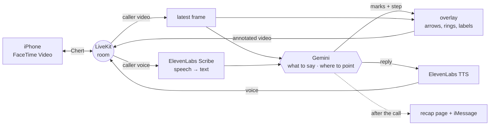

<div align="center">

# Mentor

**FaceTime an AI that can see your project and point at it.**

You call it from the normal FaceTime app. It looks through your camera, draws arrows on *your own live video*,<br>
talks you through the build one step at a time, and texts you a recap when you hang up.

[How it works](#how-it-works) · [Run it](#run-it) · [Design notes](#design-notes) · [Built at HackUTA 2026](#built-at-hackuta-2026)

</div>

---

> In Homer's *Odyssey*, the goddess Athena takes the form of an old friend, **Mentor**, and guides young Telemachus
> step by step. That story is where the word *mentor* comes from. This project tries to give that kind of guide
> to anyone holding a phone and a pile of parts.

## The Odyssey, mapped

| In Homer | In Mentor |
|---|---|
| Telemachus, young and stuck, not knowing where to start | You, holding a board you've never used |
| Athena arrives *disguised* as Mentor, an old friend | An AI that arrives as an ordinary FaceTime contact: no app, no new interface |
| She doesn't sail the ship for him; she shows him what to do next | Mentor never does the build. It points at the next thing on *your* camera and waits for you |
| The voyage, one island at a time | The build, one step at a time, each one checked on camera |
| *Nostos*, the homecoming | "Done. You made it home." The LED blinks, and the recap arrives |

**Every Telemachus deserves a Mentor.**

## The problem

When you're stuck on something physical, like wiring a board, fixing a device or assembling a kit, text instructions
and videos can't see *your* parts. A chatbot can't point. The person who could help is rarely sitting next to you.

## What Mentor does

1. **You FaceTime it.** It's a plain FaceTime Video call from an iPhone, with no app to install.
2. **It asks to see your parts**, and asks you to move closer if it can't make something out. It doesn't guess.
3. **It points.** Yellow arrows, rings and labels land on the exact port, LED or header in *your* camera feed,
   sent back into the call as live video, along with a caption showing the current step.
4. **It talks you through it**, one short step at a time, and checks each step on camera before moving on.
5. **After the call it texts you a recap** over iMessage: what you did, the annotated step screenshots,
   your final code, and a link to try that code in a simulator.

The demo task is *"I just got an Arduino, make it blink"*, but nothing in the engine is Arduino-specific.
The task is one line of configuration.

## How it works



- **[Chert](https://www.trychert.com)** gives the agent a real Apple line. It answers FaceTime and bridges the call
  into a [LiveKit](https://livekit.io) room, and it sends iMessages.
- **The agent** (Node, `@livekit/agents`) joins that room. It keeps only the newest frame of the caller's camera and
  publishes its own video track at 15 fps: the caller's frame with Mentor's marks drawn on top.
- **ElevenLabs** does the listening (Scribe v2 realtime) and the speaking (Flash v2.5).
- **Gemini** (gemini-3.5-flash) is the brain; Claude Fable 5.2 is a drop-in alternative (`MENTOR_BRAIN=claude`). Each time
  you finish speaking, it gets what you said plus the current frame and returns structured JSON: a sentence to say, up to
  three points to mark, the current step, and a recap note. It is called once per spoken turn, never per frame
  (about 2.6 s and 1.5k tokens a turn in testing).

## Run it

### You need

- Node.js 22.23+, 24 or 26
- An iPhone with FaceTime
- A **Chert** line (free trial): `npx @trychert/facetime@0.1.0-beta.21 onboard`
- A **LiveKit Cloud** project (free tier) for the room
- A brain key: **Gemini** (free via Google AI Studio) *or* **Anthropic** (Claude Fable 5.2)
- An **ElevenLabs** API key

### Set up

```sh
git clone <this repo> mentor && cd mentor
cp env.example .env          # then fill it in (never commit .env)
cd agent && npm install
npm run status               # is the Chert line ready? (needs CHERT_API_KEY + CHERT_PROJECT_ID)
```

### Start a call

```sh
# terminal 1, in agent/
npm start

# terminal 2, in agent/  (chert = npx --yes @trychert/facetime@0.1.0-beta.21)
chert setup --env-file ../.env --project <your-project-id>   # once
chert doctor
chert dev --agent <your AGENT_NAME>
```

FaceTime **Video** the number `chert dev` shows. Mentor greets you as soon as the call connects.

### The laptop screen

While a call is live, open **http://localhost:8790**: the same picture the caller sees (with Mentor's marks), the current
step, and the conversation as it happens, including how long Mentor thought. It's local only and reconnects by itself between calls.

### Optional: the recap

```sh
npm run recaps                                   # serves recap pages on localhost:8787
cloudflared tunnel --url http://localhost:8787   # put the https URL in MENTOR_PUBLIC_URL
```

With `MENTOR_SEND_RECAP=1`, Mentor texts the recap to `MENTOR_RECAP_TO` when the call ends. Without it, the recap is
only saved locally in `runs/<call>/`. On the trial line, the phone must have texted the line within the last 24 hours.

### Test without a phone

```sh
# the brain on a still photo; writes photo.jpg.mentor.png with the marks drawn on
npm run try-brain -- photo.jpg "how do I make it blink?"

# the whole video path on your LiveKit project: a fake caller streams the photo as its camera,
# Mentor answers one scripted question, and the frames Mentor sends back are saved as out-*.png
MENTOR_TEST_TURN="how do I make it blink?" npm start     # terminal 1
npm run e2e -- photo.jpg ./e2e-out                      # terminal 2
```

Without an ElevenLabs key the agent runs video-only (it logs what it would have said).

## Configuration

All settings are environment variables in `mentor/.env` (see [`env.example`](env.example)).

| Variable | Required | What it is |
|---|---|---|
| `LIVEKIT_URL`, `LIVEKIT_API_KEY`, `LIVEKIT_API_SECRET` | yes | One LiveKit project, the same one `chert setup` uses |
| `AGENT_NAME` | yes | Unique dispatch name, the same one passed to `chert dev --agent` |
| `ANTHROPIC_API_KEY` | one brain key | Claude API key (Claude Fable 5.2 brain) |
| `GEMINI_API_KEY` | one brain key | Gemini API key (Gemini brain, points on its native 0-1000 grid) |
| `MENTOR_BRAIN` | no | `gemini`, `claude` (API key) or `claude-code` (**owner testing only**: the local Claude Code CLI signed in with your own Claude subscription; never for other people's calls); otherwise Claude if its key is set, else Gemini |
| `ELEVENLABS_API_KEY` | yes | ElevenLabs key with Text to Speech + Speech to Text (`ELEVEN_API_KEY` also works) |
| `ELEVEN_VOICE_ID` | no | Voice for Mentor; ElevenLabs default if unset |
| `MENTOR_TASK` | no | The task Mentor guides, e.g. `Make the Arduino Uno's onboard LED blink` |
| `MENTOR_EFFORT` | no | Claude effort, `low` (default, fastest) or `medium` |
| `MENTOR_GEMINI_MODELS` | no | Gemini models to try in order (default `gemini-3.5-flash,gemini-3.5-flash-lite,gemini-2.5-flash`); on a rate limit or overload Mentor moves to the next |
| `MENTOR_GEMINI_THINKING` | no | `LOW` (default) or `MINIMAL` (faster) |
| `MENTOR_OUT` | no | `portrait` (default, 540×960, fills the caller's phone) or `landscape` (640×360 × `MENTOR_OUT_SCALE`) |
| `MENTOR_GREETING` | no | The first line Mentor says |
| `CHERT_API_KEY`, `CHERT_PROJECT_ID` | for recap/status | Project API key (`ftk_…`) from the Chert Developer page |
| `MENTOR_RECAP_TO` | for recap | Phone number to text the recap to (must be verified on the project) |
| `MENTOR_PUBLIC_URL` | for recap | Public URL of the recap server (tunnel) |
| `MENTOR_SEND_RECAP` | for recap | `1` to actually send the iMessage |

## Project layout

```
mentor/
├── agent/
│   ├── agent.mjs          the call: camera in, annotated video out, voice, step screenshots
│   ├── brain.mjs          Claude Fable 5.2, one structured request per spoken turn (+ brain picker)
│   ├── brain-gemini.mjs   same contract on Gemini
│   ├── overlay.mjs        draws what the caller sees (≈3 ms per frame)
│   ├── live.mjs           local WebSocket for the laptop screen (monitor.html)
│   ├── recap.mjs          recap page + iMessage text (Chert API)
│   ├── send-recap.mjs     runs after each call in its own process
│   ├── serve-recaps.mjs   read-only server for recap pages
│   ├── status.mjs         checks the Chert line's readiness flags
│   ├── try-brain.mjs      test the brain on a still photo
│   ├── check-keys.mjs     checks every key in .env without printing it
│   ├── test/e2e-video.mjs fake caller for an end-to-end video test on LiveKit
│   ├── chert-rooms.mjs    from Chert's video-agent starter (unchanged)
│   └── greet.mjs          from Chert's video-agent starter (unchanged)
├── env.example
└── runs/                  per-call screenshots and recaps (git-ignored)
```

## Design notes

- **Point at what it can see, ask for the rest.** Mentor is told never to guess a pin it can't see. It asks you to
  move closer, and marks a region (the header block, the LED corner) rather than a single pin it isn't sure of.
- **One model call per turn, not per frame.** The camera runs at 15 fps but Claude only sees the frame from the
  moment you finish speaking. Older turns, images included, are prompt-cached, so a five-minute call stays cheap.
- **Append-only conversation.** Every request and reply goes back to Claude unchanged, including its thinking
  blocks, so the history stays valid and the cache keeps hitting.
- **Looks like it belongs on a phone.** Thin yellow rings with a soft shadow, solid labels that never overlap (each tries
  left, right, above and below its mark and takes the first free spot), and the step as a floating pill. Inter, bundled.
- **AR wires.** When a wire or cable has to go somewhere, Mentor draws it in place on your video: a bowed cable from
  where it starts to the hole it goes into, with light flowing toward the target.
- **Works on your camera, not FaceTime's frame.** The incoming picture arrives with black bars; Mentor finds the real
  image, crops to it (a bigger, clearer view for the brain) and sends portrait video back so it fills your screen.
- **Marks fade.** Arrows clear after 25 seconds of silence, so stale arrows never point at a spot the camera has
  moved away from. If your camera turns off, Mentor drops the old frame instead of judging an old view.
- **Greets on time.** FaceTime hangs up on an agent that stays silent for 10 seconds after connecting, so the greeting
  is a fixed line spoken the moment Chert reports the bridge is ready. It doesn't wait on a model call.
- **Recap survives the hang-up.** The recap is built in its own process, so it finishes even after the call's job
  is torn down. The recap server only serves pages and images from random, unguessable folder names.
- **Safety.** Mentor tells you to unplug power before rewiring, and it never declares a circuit "safe".

## Limits

- Gemini's free tier allows about **20 requests a day per model**. Mentor falls through `MENTOR_GEMINI_MODELS` when one
  runs out, but a full demo day needs a paid key. `npm run check-keys` checks keys without spending any requests.

- The free Chert trial allows calls of up to 5 minutes, and the line handles one call at a time.
- The caller's camera only reaches the agent if caller capture is enabled on the Chert line.
- Pin-level pointing on tiny headers depends on how close and how sharp the camera is.

## Built at HackUTA 2026

Built in 12 hours for the HackUTA 2026 theme *Homer's Odyssey*, for the **Best Use of FaceTime (Chert)** and
**Best Use of ElevenLabs** tracks.

**Built with:** Chert · LiveKit Agents · ElevenLabs (Scribe v2 realtime, Flash v2.5) · Gemini · Claude Fable 5.2 (optional) ·
@napi-rs/canvas · Node.js

## License

MIT for Mentor's own code (see [LICENSE](LICENSE)). `agent/chert-rooms.mjs` and `agent/greet.mjs` come from Chert's
`chert new --video` starter and keep Chert's terms.
